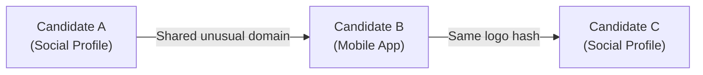

# BrandShield AI — Digital Risk Protection

> **Kampus.VC Social & App Monitoring Hackathon**: Explainable, deterministic brand impersonation monitoring across social media and mobile app ecosystems.

BrandShield AI helps security analysts, brand protection teams, and investigators discover and investigate possible brand impersonation across public social profiles and mobile app listings.

Unlike opaque machine learning models that generate unexplainable scores or hallucinate threats, BrandShield AI relies on a **deterministic, multi-signal scoring engine**, an **official-asset pre-scoring safety guard**, and an **evidence-based campaign graph**.

---

## Workflow Overview

BrandShield AI operates through a straightforward five-step workflow:

```text
[ 1. Discover Candidates ] ──▶ [ 2. Check Official Assets ] ──▶ [ 3. Calculate Risk Score ]
                                                                             │
[ 5. Explore Campaign Connections ] ◀─────── [ 4. Review Evidence ] ◀────────┘
```

1. **Discover Candidates**: Discovers potential impersonators across public sources (such as Bluesky and Apple App Store) or accepts manual analyst submissions.
2. **Check Official Assets**: Automatically validates candidate handles, domains, and developer IDs against registered official brand assets. Verified properties receive an `OFFICIAL_EXCLUDED` status and a score of 0, preventing false alerts on authentic brand channels.
3. **Calculate Risk Score**: Evaluates non-official candidates through six transparent signal families, producing an explainable 0–100 risk score and severity classification.
4. **Review Evidence**: Provides structured evidence cards and triage actions (*Investigate*, *Resolve*, *False Positive*) with complete provenance and audit logs.
5. **Explore Campaign Connections**: Links related candidates into an Impersonation Campaign Graph based strictly on shared technical indicators (e.g., identical phishing domains, developer IDs, or logo hashes).

---

## Live Deployment

BrandShield AI is deployed and live across Vercel, Render, and MongoDB Atlas:

| Component | Platform | URL / Endpoint | Purpose |
| :--- | :--- | :--- | :--- |
| **Frontend Web App** | Vercel | [https://brandshield-ai-puce.vercel.app](https://brandshield-ai-puce.vercel.app) | React web interface for dashboard, scans, investigations, and graph analysis |
| **Backend API** | Render | [https://brandshield-ai-xkga.onrender.com](https://brandshield-ai-xkga.onrender.com) | FastAPI REST service handling detection, graph building, and connector ingestion |
| **Backend Health Check** | Render | [https://brandshield-ai-xkga.onrender.com/api/v1/health](https://brandshield-ai-xkga.onrender.com/api/v1/health) | Readiness check verifying API status and MongoDB Atlas database connection |
| **Interactive API Docs** | Render | [https://brandshield-ai-xkga.onrender.com/docs](https://brandshield-ai-xkga.onrender.com/docs) | OpenAPI Swagger UI for inspecting endpoints and schemas |
| **Database** | MongoDB Atlas | *Managed Cloud Replica Set* | Secure document store for brand profiles, candidates, and user accounts |

### Deployment Architecture

```text
┌─────────────────────────────────┐
│     User Web Browser            │
│  (React 19 + TypeScript + Vite) │
└────────────────┬────────────────┘
                 │ Loads static assets from Vercel
                 ▼
┌─────────────────────────────────────────────────────────┐
│               Frontend Hosted on Vercel                 │
│         https://brandshield-ai-puce.vercel.app          │
└────────────────┬────────────────────────────────────────┘
                 │ Sends authenticated REST API calls (Bearer JWT)
                 ▼
┌─────────────────────────────────────────────────────────┐
│             FastAPI Backend Hosted on Render            │
│          https://brandshield-ai-xkga.onrender.com       │
├────────────────────────────┬────────────────────────────┤
│   Official-Asset Guard     │  Detection Scoring Engine  │
│   Campaign Graph Service   │  Role-Based Auth (Argon2)  │
└──────┬─────────────────────┴─────────────┬──────────────┘
       │ Ingests public search data        │ Reads & writes app state
       ▼                                   ▼
┌──────────────────────────────┐  ┌──────────────────────────────┐
│  Public Source Connectors    │  │   MongoDB Atlas (Cloud DB)   │
│  - Bluesky Public XRPC API   │  │  - brandshield_dev (App DB)  │
│  - Apple iTunes Search API   │  │  - brandshield_test (Test DB)│
└──────────────────────────────┘  └──────────────────────────────┘
```

1. The user's browser loads the modern React frontend from **Vercel**.
2. The frontend sends authenticated API requests to the FastAPI backend running on **Render**.
3. The backend retrieves public-source search results from **Bluesky** and **Apple iTunes Search**.
4. The backend applies pre-scoring **official-asset exclusions** and deterministic **risk-scoring algorithms**.
5. **MongoDB Atlas** persists brand configurations, candidates, audit history, and campaign relationships.
6. The frontend displays the dashboard, scans, evidence cards, and campaign graphs.

### Deployment Configuration Settings

#### Frontend Environment Variable (Vercel)
| Variable | Value | Description |
| :--- | :--- | :--- |
| `VITE_API_BASE_URL` | `https://brandshield-ai-xkga.onrender.com` | Base URL pointing the React application to the deployed backend on Render. |

> *Note*: Any modification to environment variables in Vercel requires triggering a new frontend deployment to bundle the updated settings.

#### Backend Environment Variables (Render)
| Variable | Description | Value Requirement |
| :--- | :--- | :--- |
| `MONGODB_URI` | MongoDB Atlas replica set connection string | Confidential connection URI configured in Render dashboard |
| `DATABASE_NAME` | Active production application database | `brandshield_dev` |
| `TEST_DATABASE_NAME` | Isolated test database for test runs | `brandshield_test` |
| `JWT_SECRET_KEY` | Cryptographic secret for signing JWT access tokens | 32+ character random secret string |
| `JWT_ALGORITHM` | Algorithm used for JWT signatures | `HS256` |
| `ACCESS_TOKEN_EXPIRE_MINUTES` | Access token lifespan in minutes | `60` |
| `FRONTEND_ORIGINS` | Allowed CORS origins for browser API requests | Must include `https://brandshield-ai-puce.vercel.app` (and local ports for dev) |
| `ENVIRONMENT` | Server execution environment | `production` |
| `PORT` | Web service listen port | Injected dynamically by Render (`8000` locally) |

#### Render Web Service Settings
* **Root Directory**: `brandshield-ai/backend`
* **Python Runtime**: Python 3.12 (pinned via `.python-version` to ensure pre-compiled binary wheel installation)
* **Build Command**: `pip install -r requirements.txt`
* **Start Command**: `uvicorn app.main:app --host 0.0.0.0 --port $PORT`

> **Note on Render Free Tier**: Render web services enter sleep mode after 15 minutes of inactivity. The first request after a sleep period may take ~50 seconds to complete while the instance spins up. Pinging `https://brandshield-ai-xkga.onrender.com/api/v1/health` prior to an evaluation warms up the service.

---

## How Campaign Graph Edges Work

The **Impersonation Campaign Graph** visualizes relationships between discovered candidates to identify potential coordinated threat networks across social profiles and mobile apps.

### Graph Fundamentals

* **Node**: Represents a discovered candidate, such as a social media account or mobile app listing.
* **Edge**: A connection linking two candidates when they share a supported, concrete technical indicator.


*Caption: Illustrative diagram demonstrating how candidates are linked by concrete technical indicators. This diagram is for explanatory purposes and does not represent actual findings.*

### Supported Technical Indicators
The graph creates an edge between two candidates **only** when they share one of the following concrete indicators:

| Indicator Type | Internal Key | Description |
| :--- | :--- | :--- |
| **Identical Unusual Domain** | `exact_normalized_domain` | Both candidates link to the exact same non-generic external website or phishing domain (e.g., `secure-brand-portal.com`). |
| **Publisher / Developer ID** | `publisher_id` | App store listings registered under the exact same developer account identifier. |
| **Perceptual Logo Hash** | `perceptual_hash` | Candidates using the identical custom image or logo (computed via dHash/pHash perceptual hashing). |
| **Contact Email** | `contact_email` | Candidates providing the exact same contact email address in public descriptions or bio fields. |
| **Contact Phone** | `contact_phone` | Candidates listing the identical customer support telephone number. |

### Strict Non-Edge & Exclusion Rules

To eliminate false links, the Campaign Graph enforces strict filtering:

1. **Generic Platforms Excluded**: Shared links to generic services (e.g., `bit.ly`, `tinyurl.com`, `linktr.ee`, `github.io`, `vercel.app`, `carrd.co`, `google.com`, `apple.com`, `bsky.app`) are automatically excluded. Two accounts linking to `linktr.ee` will **never** be linked based on that domain alone.
2. **Name Similarity Alone Never Creates an Edge**: Two candidates having identical or similar display names (e.g., "Brand Support" and "Brand Help") will **never** be connected unless they share a qualifying technical indicator.
3. **Official Asset Non-Edges**: Official brand domains and verified developer accounts are excluded so legitimate infrastructure is never labeled as part of an impersonation campaign.
4. **Investigative Lead, Not Legal Proof**: Graph groups are labeled as `POTENTIAL_COORDINATION`. An edge serves as an investigative lead for analysts to prioritize multi-channel takedowns; it does not assert legally proven common ownership or criminal conspiracy.

---

## Risk Scoring Engine

BrandShield AI employs a multi-signal risk calculation engine that outputs an explainable risk score from **0 to 100**.

### Scoring Signals & Point Allocations

| Signal Family | Max Points | Implementation Logic |
| :--- | :---: | :--- |
| **Normalized Name Similarity** | **35** | Evaluated on compact normalized strings: Exact compact match = 35 pts, High similarity (≥ 0.90) = 30 pts, Medium similarity (0.80–0.89) = 20 pts, Low token overlap (0.70–0.79) = 8 pts, No match (< 0.70) = 0 pts. |
| **Evasion Bonuses** | *(Bonus)* | Applied to name similarity when evasion tactics are detected (takes largest single applicable bonus; does not sum):<br/>• **Homoglyphs / Leetspeak** (e.g., `N0vaPay`, Cyrillic confusable): **+8 pts**<br/>• **Added Scam / Generic Words** (e.g., `NovaPay Support`): **+6 pts**<br/>• **Spacing Manipulation** (e.g., `Nova Pay`): **+3 pts** |
| **Look-alike Domain** | **25** | External website or profile link is confusingly similar to the official brand domain (RapidFuzz similarity ≥ 0.72) but not identical. |
| **Publisher Mismatch** | **20** | App Store developer ID does not match the official developer ID (20 pts). If developer information is missing entirely, 8 pts are assigned with a missing evidence flag. |
| **Scam Language** | **15** | Profile bio or app description contains recognized phishing, giveaway, or urgency terms (e.g., `giveaway`, `dm to claim`, `refund`, `verify wallet`, `account suspended`). |
| **Perceptual Image Similarity** | **15** | Perceptual image hash (dHash/pHash) matches the official brand logo within a Hamming distance threshold (applied only when a real image exists). |
| **Description Semantics** | **10** | Token-set text similarity between candidate description and the brand's official description. |

### Anti-Double-Counting & The Name-Only Ceiling

* **Name Family Cap (40 points)**: The sum of `Name Similarity + Evasion Bonus` is strictly capped at **40 points**.
* **Why Multiple Signals Matter**: Similar or identical names alone cannot exceed a score of 40 (Medium severity). A candidate cannot reach **High** (70+) or **Critical** (85+) severity without corroborating technical evidence, such as a look-alike phishing domain, an unauthorized publisher ID, or deceptive scam phrasing.
* **Prioritization, Not Probability**: The risk score is an explainable triage indicator designed to help analysts prioritize high-threat candidates; it is not a statistical probability of fraud.

### Severity Bands

| Severity Band | Score Range | Operational Meaning & Recommended Action |
| :--- | :---: | :--- |
| **Critical** | **85 – 100** | Immediate triage required. High-confidence impersonation showing multiple corroborating indicators (e.g., look-alike domain + publisher mismatch + logo imitation). |
| **High** | **70 – 84** | High priority. Strong evidence of unauthorized brand use or targeted deceptive phrasing. |
| **Medium** | **40 – 69** | Potential threat. Sufficient similarity to warrant analyst review; meets the minimum threshold for active alert tracking. |
| **Low** | **0 – 39** | Low risk. Incidental keyword overlap or coincidental name similarity without supporting threat indicators. |

---

## Live Data vs. Synthetic Data

BrandShield AI maintains explicit provenance tracking for every record in the system:

| Provenance Type (`source_type`) | Description | Use Case & Operational Behavior |
| :--- | :--- | :--- |
| `live_connector` | Real records retrieved dynamically from connected public sources (Bluesky XRPC search, Apple iTunes search) during an on-demand scan. | Primary operational data. Scans are initiated on demand, and live results may change as public platforms update. Public records represent unvetted candidates that require analyst review. |
| `demo` | Deterministic synthetic records created with known ground-truth indicators and risk traits. | Used for reproducible demonstrations, evaluation, and automated testing. Synthetic records are flagged (`is_demo_data: true`) and are **never** substituted for live findings during network outages. |
| `manual` | Suspicious profiles or apps directly submitted by an analyst via the application UI or API. | Allows analysts to triage targeted suspect URLs or incoming incident reports. |

---

## Key Features & Platform Guarantees

1. **Pre-Scoring Official-Asset Safety Guard**:
   * Official brand assets (verified handles, DIDs, website domains, App Store bundle IDs, developer IDs) are evaluated *before* scoring.
   * Legitimate properties receive an `OFFICIAL_EXCLUDED` status and a score of 0, excluding them from active alert metrics.
2. **Transparent Provenance & Evidence Cards**:
   * Every record maintains explicit origin attribution (`live_connector`, `demo`, or `manual`).
   * Expandable evidence drawers display exact signal breakdowns, matched phrases, domain comparisons, and missing evidence warnings.
3. **Role-Based Authentication & User Management**:
   * Secure user registration and login with Argon2id password hashing and RFC-compliant signed JWT tokens.
   * Server-enforced role assignments: public sign-ups are strictly assigned the `analyst` role; administrative operations (user management) require verified `admin` credentials.
4. **Database Safety & Test Isolation**:
   * Automated tests execute exclusively against an isolated database (`brandshield_test`), guaranteeing zero mutations or deletions in the operational `brandshield_dev` database.

---

## Technology Stack

* **Frontend**: React 19, TypeScript, Vite, Tailwind CSS, React Router, Lucide Icons
* **Backend**: Python 3.12, FastAPI, Pydantic v2, PyMongo, HTTPX, RapidFuzz, Pillow, ImageHash, `pwdlib[argon2]`, PyJWT
* **Database**: MongoDB Atlas (Cloud NoSQL)
* **Testing**: Pytest (104 automated tests), TypeScript Compiler (`tsc`)
* **Deployment**: Vercel (Frontend), Render (Backend Web Service)

---

## Local Setup & Execution

### Prerequisites
* Python 3.12 (or 3.11+)
* Node.js 18+ and `npm`
* MongoDB Atlas cluster connection string (or local MongoDB 6+)

### 1. Backend Setup

```bash
cd brandshield-ai/backend

# Create and activate virtual environment
python -m venv venv

# Windows:
venv\Scripts\activate
# Linux/macOS:
source venv/bin/activate

# Install dependencies
pip install -r requirements.txt

# Configure environment variables
cp .env.example .env
# Edit .env with your MONGODB_URI, database names, and JWT_SECRET_KEY

# Bootstrap initial administrator account (runs once against configured MongoDB):
python -m app.cli.bootstrap_admin --email admin@brandshield.ai --password "YourStrongPassword123!"
```

Run backend automated tests:
```bash
pytest -v
```

Start backend development server:
```bash
uvicorn app.main:app --reload --port 8000
```

Verify backend health:
* Process health: `http://localhost:8000/health`
* Readiness & DB connection: `http://localhost:8000/api/v1/health`
* Interactive OpenAPI Swagger docs: `http://localhost:8000/docs`

### 2. Frontend Setup

```bash
cd brandshield-ai/frontend

# Install dependencies
npm install

# Configure environment
cp .env.example .env
# Verify VITE_API_BASE_URL=http://localhost:8000

# Start development server
npm run dev

# Run production build validation
npm run build
```

The frontend will be available locally at `http://localhost:5173`.

---

## Environment Variables Reference

### Backend (`brandshield-ai/backend/.env`)
| Variable | Description | Example / Default |
| :--- | :--- | :--- |
| `MONGODB_URI` | MongoDB Atlas connection string | `mongodb+srv://<user>:<password>@cluster.mongodb.net/?retryWrites=true&w=majority` |
| `DATABASE_NAME` | Operational application database | `brandshield_dev` |
| `TEST_DATABASE_NAME` | Dedicated database for automated tests | `brandshield_test` |
| `JWT_SECRET_KEY` | Secret key for signing JWT access tokens | Random 32+ character string |
| `JWT_ALGORITHM` | JWT signing algorithm | `HS256` |
| `ACCESS_TOKEN_EXPIRE_MINUTES` | Access token expiration in minutes | `60` |
| `FRONTEND_ORIGINS` | Permitted CORS origins (comma-separated) | `http://localhost:5173,http://localhost:3000,https://brandshield-ai-puce.vercel.app` |
| `ENVIRONMENT` | Server execution environment | `development` / `production` |
| `PORT` | Local server port | `8000` |

### Frontend (`brandshield-ai/frontend/.env`)
| Variable | Description | Example / Default |
| :--- | :--- | :--- |
| `VITE_API_BASE_URL` | Base URL of the FastAPI backend | `http://localhost:8000` (local) or `https://brandshield-ai-xkga.onrender.com` (prod) |

---

## Live Connectors & Ingestion Boundaries

BrandShield AI connects to public, unauthenticated APIs without requiring proprietary developer keys:

1. **Apple iTunes Search API (`software` entity)**:
   * Endpoint: `https://itunes.apple.com/search`
   * Allowlisted hosts: `itunes.apple.com` and `*.mzstatic.com`
   * Rate limit: ~20 requests per minute
2. **Bluesky Public XRPC Search (`searchActors`)**:
   * Endpoint: `https://public.api.bsky.app/xrpc/app.bsky.actor.searchActors`
   * Allowlisted hosts: `public.api.bsky.app` and `cdn.bsky.app`
   * Rate limit: ~300 requests per 5 minutes per IP

### Network Boundaries & Graceful Degradation
* Requests have strict 8.0s timeouts and a 2 MB response size cap.
* Arbitrary user-supplied URLs are strictly restricted to prevent SSRF vulnerabilities.
* When an upstream source is unreachable, BrandShield AI reports that connector as degraded, continues processing available sources, and **never substitutes fake synthetic data**.

---

## Automated Testing & Quality Assurance

The test suite validates security, scoring accuracy, official-asset guards, and campaign graph logic:

```bash
cd brandshield-ai/backend
pytest tests/
```

* **Test Suite Status**: **104 passed, 2 skipped** (live connector integration tests skipped when running in offline mode) across 10 test modules.
* **Key Areas Covered**:
  * Role-based access control and public registration security (`test_auth.py` — 22 tests)
  * Multi-signal scoring and evasion bonuses (`test_detection_engine.py` — 20 tests)
  * Official-asset pre-scoring exclusions (`test_brands.py` — 12 tests)
  * Campaign graph indicator extraction and generic exclusions (`test_campaign_graph.py` — 7 tests)
  * Social and app monitoring connectors (`test_social_monitoring.py`, `test_app_monitoring.py`)
  * Acceptance benchmarks and ground truth verification (`test_prompt08_acceptance.py` — 10 tests)
* **Frontend Verification**: TypeScript compilation (`tsc`) and Vite production bundle (`vite build`) build with 0 errors.

---

## Limitations & Honest Scoping

1. **Connector Scoping**:
   * Google Play Store, Instagram, and X (Twitter) are not included in this prototype because they do not offer unauthenticated, keyless public REST endpoints.
2. **Cloud Cold Starts**:
   * Free-tier backend hosting on Render spins down instances after periods of inactivity. An initial request may experience a ~50-second wake-up latency.
3. **Attribution Boundaries**:
   * Campaign clusters represent shared technical indicators, not proven legal ownership or criminal conspiracy. All clusters are categorized as `POTENTIAL_COORDINATION`.

---

## Project Documentation & Resources

* [`docs/architecture.md`](docs/architecture.md): Complete dataflow, pre-scoring safety guard, and architectural diagrams.
* [`docs/architecture.png`](docs/architecture.png): High-resolution architecture visual for presentations.
* [`docs/sources.md`](docs/sources.md): Public connector endpoints, parameters, field mappings, and rate limits.
* [`docs/test-results.md`](docs/test-results.md): Observed test results and scoring validation matrix.
* [`docs/demo-script.md`](docs/demo-script.md): Timed presentation and live walkthrough script.
* [`docs/presentation-outline.md`](docs/presentation-outline.md): Hackathon pitch outline.

---

## Project Links

* **Live Frontend**: [https://brandshield-ai-puce.vercel.app](https://brandshield-ai-puce.vercel.app)
* **Live API**: [https://brandshield-ai-xkga.onrender.com](https://brandshield-ai-xkga.onrender.com)
* **API Documentation**: [https://brandshield-ai-xkga.onrender.com/docs](https://brandshield-ai-xkga.onrender.com/docs)
* **API Health**: [https://brandshield-ai-xkga.onrender.com/api/v1/health](https://brandshield-ai-xkga.onrender.com/api/v1/health)
* **GitHub Repository**: [https://github.com/theja8458/brandshield-ai](https://github.com/theja8458/brandshield-ai)
