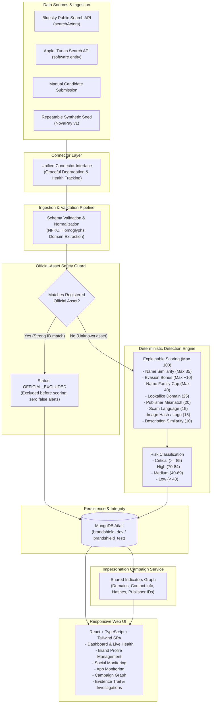

# BrandShield AI — System Architecture

BrandShield AI is an explainable, deterministic Digital Risk Protection (DRP) prototype designed for monitoring social-media and mobile-app impersonation.

## Architecture Diagram

## Core Architectural Guarantees

1. **Official-Asset Exclusion Before Scoring**:
   Registered official assets (canonical URLs, verified handles, stable account IDs, package/bundle IDs) are matched and excluded *before* any risk calculation takes place. This guarantees zero false positive alerts on legitimate brand properties.

2. **Deterministic & Explainable Scoring**:
   Risk scores are calculated by an open, rules-based algorithm rather than opaque black-box models. Every assigned point includes an auditable evidence reason and matched indicator.

3. **Name-Only Ceiling**:
   A similar name alone cannot exceed 40 points (Medium). It requires corroborating signals (look-alike domain, publisher mismatch, scam phrases, or matching visual hashes) to reach High or Critical severity.

4. **Transparent Provenance**:
   Every record is tagged with its origin (`live_connector`, `manual`, or `demo`), preventing any confusion between live network data and synthetic demo data.

5. **Storage & Isolation**:
   MongoDB Atlas stores brand profiles, candidate telemetry, and investigation logs. Unit and integration tests run strictly against an isolated `TEST_DATABASE_NAME`.
